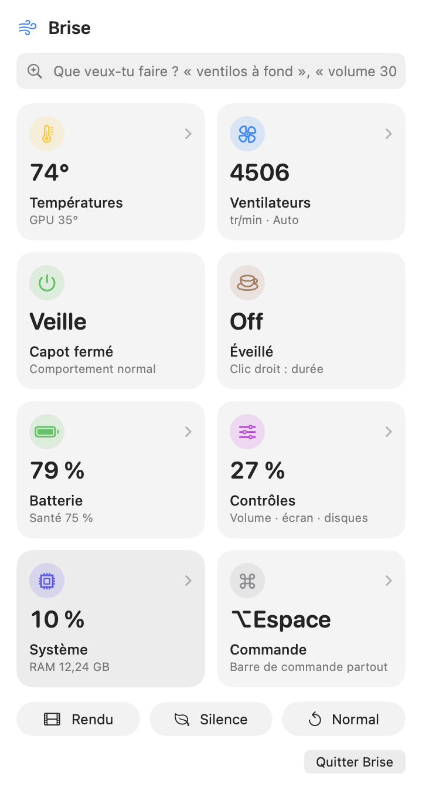
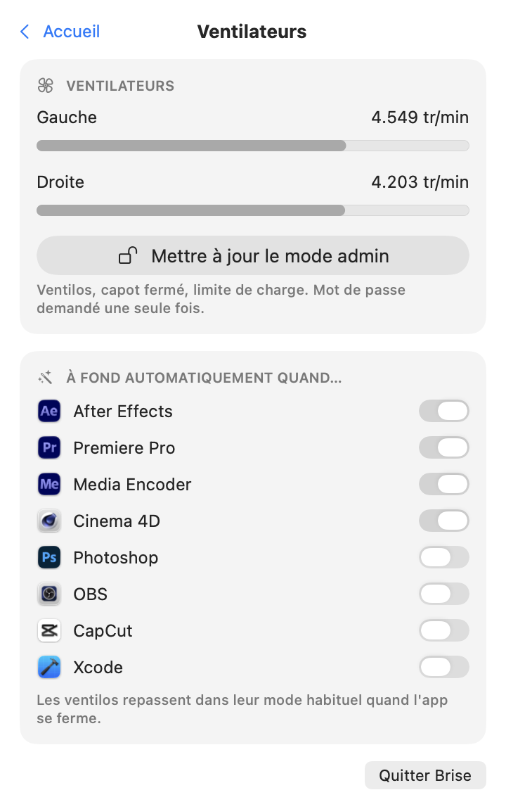

<div align="center">

# 🌬️ Brise

**A native macOS menu bar assistant: temperatures, fans, battery, power and quick Mac controls — one click or one sentence away.**

Swift · SwiftUI · IOKit · zero dependencies · ~1.6 MB universal binary

&nbsp;&nbsp;

</div>

---

## Why

My MacBook Pro 16" (2019, i9) runs hot. Existing tools show temperatures *or* control fans *or* show system stats, and most are paid or bloated. Brise puts everything I actually check in one glance from the menu bar, and lets me go full blast before a render instead of after.

## Features

**Home screen of tiles**, like Control Center: tap a tile to open its page, or flip a power tile on and off.

- 🌡️ **Temperatures** — CPU (average of all cores) and GPU in the menu bar, a 3-minute chart, every SMC sensor (47 on a MacBookPro16,1).
- 🌀 **Fans** — *Auto*, *Full blast* or a custom speed, scaled to each fan's real min/max.
  - **Auto boost** above a temperature you pick.
  - **Per-app automations** — fans go full blast while After Effects, Premiere, Media Encoder, Cinema 4D, DaVinci Resolve or Blender is open, and go back when you quit it.
- ⏻ **Lid closed** — keep the Mac running with the lid shut (let a render, a download or an AI agent finish). Automatically turned off on quit or below 15 % battery.
- ☕ **Keep awake** — indefinitely or for 30 min / 1 h / 2 h / 4 h.
- 🔋 **Battery** — charge, health, cycles, temperature, and a **charge limit** (stop at 80 %) to slow down battery wear on a Mac that lives on the charger.
- 🎛️ **Controls** — volume, brightness, dark mode, lock, display off, eject all disks, empty the trash.
- 🎬 **Presets** — *Render* (fans max + awake), *Silent* (Low Power Mode), *Normal* (everything back to default).
- ⌨️ **Command bar** — press **⌥Space** anywhere and type in plain French: `ventilos à fond`, `éveillé 1h`, `volume 30`, `capot fermé`, `batterie 80`, `mode rendu`, `ouvrir Figma`, `quitter Chrome`… ↑/↓ to pick, ↩ to run. Offline, instant, no AI needed.
- 🔥 **Who's heating?** — top CPU processes with one-click quit.
- 🛟 **Safe by default** — quitting Brise hands fans and sleep back to macOS.

## How it works

```
┌──────────────┐  reads (no root)     ┌──────────┐
│  Brise.app   │ ───────────────────▶ │ AppleSMC │
│  SwiftUI     │                      │  driver  │
│  MenuBarExtra│   ┌──────────────┐   │          │
│              │──▶│ brise-helper │──▶│  writes  │
└──────────────┘   │ setuid root  │   └──────────┘
                   └──────────────┘
```

- **`CSMC`** — a ~150-line C client for the AppleSMC kernel driver (`IOConnectCallStructMethod`), decoding the SMC's fixed-point types (`sp78`, `fpe2`, `flt `…).
- **`BriseCore`** — Swift wrappers: sensor discovery (enumerates every SMC key once, keeps the plausible temperature ones), fan reads and writes, with Intel (`F0Md` / `FS!`) and Apple Silicon (`Ftst`) code paths.
- **`brise-helper`** — writing to the SMC requires root. Instead of running the whole app as root, a tiny CLI is installed once as setuid root (one admin password prompt). It only accepts a fixed whitelist of commands (`set`, `max`, `auto`, `battery-limit`, `nosleep`, `purge`, `lowpower`) and clamps every value to safe limits.
- **`Brise`** — the SwiftUI app: `MenuBarExtra`, Swift Charts, Observation, Mach host statistics for CPU/RAM, `getifaddrs` for network, IOKit power sources for the battery, `IOPMAssertion` for keep-awake, `SMAppService` for launch at login, a Carbon global hot key and a borderless `NSPanel` for the command bar, `NSWorkspace` notifications for app automations.

## Install

Requires macOS 14+ and Xcode command line tools.

```bash
git clone https://github.com/mae1an/brise.git
cd brise
./scripts/build-app.sh          # universal binary in build/Brise.app
cp -R build/Brise.app /Applications/
open /Applications/Brise.app
```

Click **Activer le mode admin** once to install the helper (asks for your password). Monitoring, keep-awake and controls work without it; fans, lid closed and charge limit need it.

Debug from the terminal, no root needed:

```bash
.build/release/brise-helper dump
```

## Uninstall

```bash
sudo rm -rf "/Library/Application Support/Brise" /Applications/Brise.app
```

## Compatibility

| Mac | Temperatures | Fan control |
|---|---|---|
| Intel (T2 and earlier) | ✅ tested on MacBookPro16,1 | ✅ `F0Md` / `FS!` · charge limit via `BCLM` |
| Apple Silicon | ✅ via SMC keys (M2 and later expose the most) | ⚠️ `Ftst` path, untested · no charge limit yet |

## Disclaimer

Brise writes to your Mac's System Management Controller. Speeds are always clamped to the limits the hardware reports, and fans go back to automatic when the app quits, but you use it at your own risk.

## License

MIT
