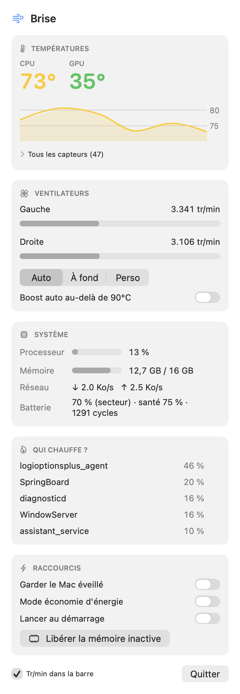

<div align="center">

# 🌬️ Brise

**A tiny, native macOS menu bar app to watch your Mac's temperatures and take control of its fans.**

Swift · SwiftUI · IOKit · zero dependencies · ~1.6 MB universal binary



</div>

---

## Why

My MacBook Pro 16" (2019, i9) runs hot. Existing tools show temperatures *or* control fans *or* show system stats, and most are paid or bloated. Brise puts everything I actually check in one glance from the menu bar, and lets me go full blast before a render instead of after.

## Features

- **Live temperatures** — CPU (average of all cores) and GPU right in the menu bar, a 3-minute history chart, and every SMC sensor the machine exposes (47 on a MacBookPro16,1).
- **Fan control** — *Auto*, *Full blast* or a custom speed slider, scaled to each fan's real min/max.
- **Auto boost** — fans jump to max when the CPU crosses a threshold you pick, and return to automatic 10 °C below it.
- **Who's heating?** — the 5 most CPU-hungry processes, with a one-click quit on hover.
- **System at a glance** — CPU load, memory pressure, network up/down, battery charge, health and cycle count.
- **Quick switches** — keep the Mac awake, Low Power Mode, free inactive memory, launch at login.
- **Safe by default** — quitting Brise always hands the fans back to macOS.

## How it works

```
┌──────────────┐  reads (no root)     ┌──────────┐
│  Brise.app   │ ───────────────────▶ │ AppleSMC │
│  SwiftUI     │                      │  driver  │
│  MenuBarExtra│   ┌──────────────┐   │          │
│              │──▶│ brise-helper │──▶│  writes  │
└──────────────┘   │ setuid root  │   └──────────┘
                   └──────────────┘
```

- **`CSMC`** — a ~150-line C client for the AppleSMC kernel driver (`IOConnectCallStructMethod`), decoding the SMC's fixed-point types (`sp78`, `fpe2`, `flt `…).
- **`BriseCore`** — Swift wrappers: sensor discovery (enumerates every SMC key once, keeps the plausible temperature ones), fan reads and writes, with Intel (`F0Md` / `FS!`) and Apple Silicon (`Ftst`) code paths.
- **`brise-helper`** — writing to the SMC requires root. Instead of running the whole app as root, a tiny CLI is installed once as setuid root (one admin password prompt). It only accepts a fixed whitelist of commands (`set`, `max`, `auto`, `purge`, `lowpower`) and clamps every speed to the hardware's own limits.
- **`Brise`** — the SwiftUI app: `MenuBarExtra`, Swift Charts, Observation, Mach host statistics for CPU/RAM, `getifaddrs` for network, IOKit power sources for the battery, `IOPMAssertion` for keep-awake, `SMAppService` for launch at login.

## Install

Requires macOS 14+ and Xcode command line tools.

```bash
git clone https://github.com/mae1an/brise.git
cd brise
./scripts/build-app.sh          # universal binary in build/Brise.app
cp -R build/Brise.app /Applications/
open /Applications/Brise.app
```

Click **Activer le contrôle des ventilos** once to install the helper (asks for your password). Monitoring works without it.

Debug from the terminal, no root needed:

```bash
.build/release/brise-helper dump
```

## Uninstall

```bash
sudo rm -rf "/Library/Application Support/Brise" /Applications/Brise.app
```

## Compatibility

| Mac | Temperatures | Fan control |
|---|---|---|
| Intel (T2 and earlier) | ✅ tested on MacBookPro16,1 | ✅ `F0Md` / `FS!` |
| Apple Silicon | ✅ via SMC keys (M2 and later expose the most) | ⚠️ `Ftst` path, untested |

## Disclaimer

Brise writes to your Mac's System Management Controller. Speeds are always clamped to the limits the hardware reports, and fans go back to automatic when the app quits, but you use it at your own risk.

## License

MIT
